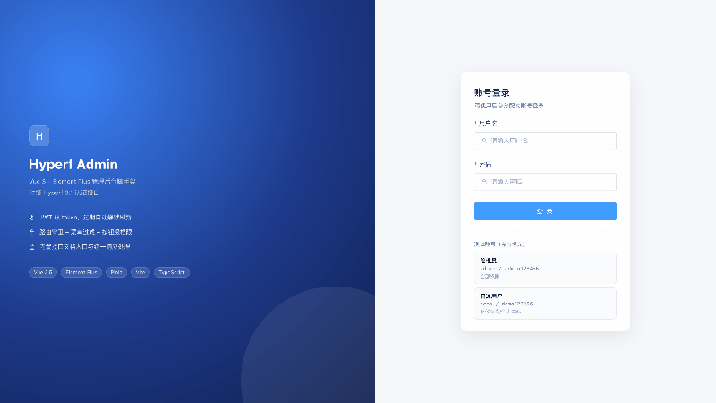
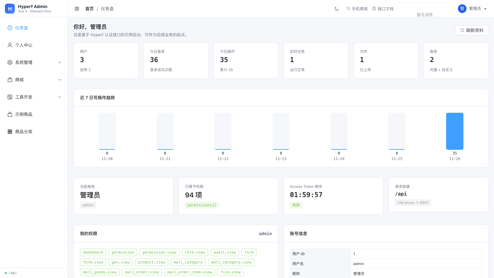
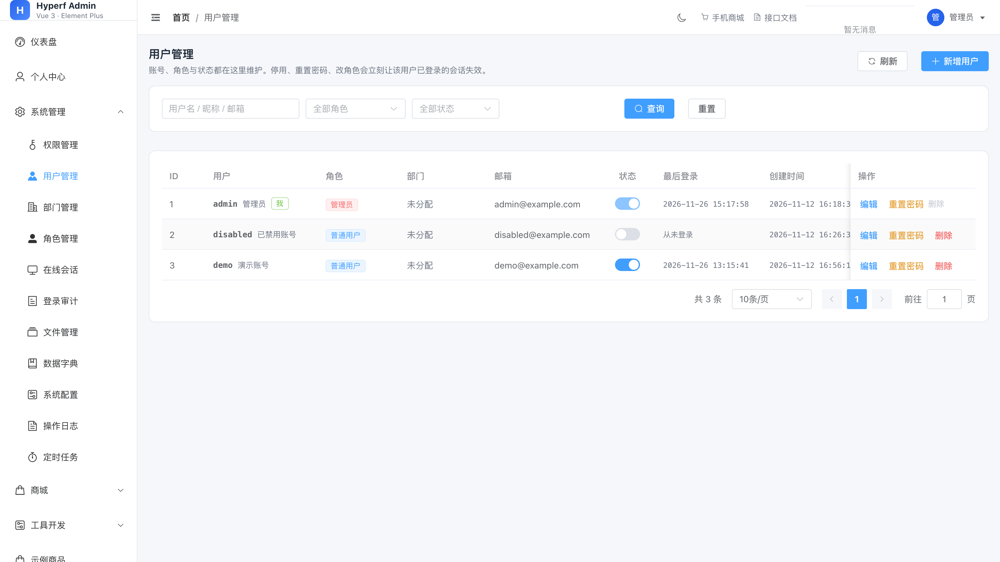
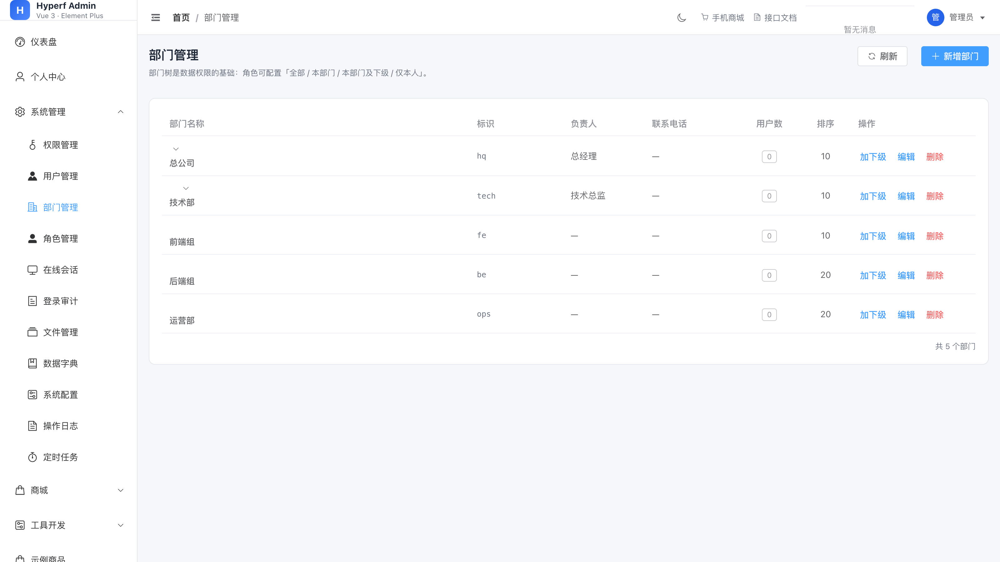
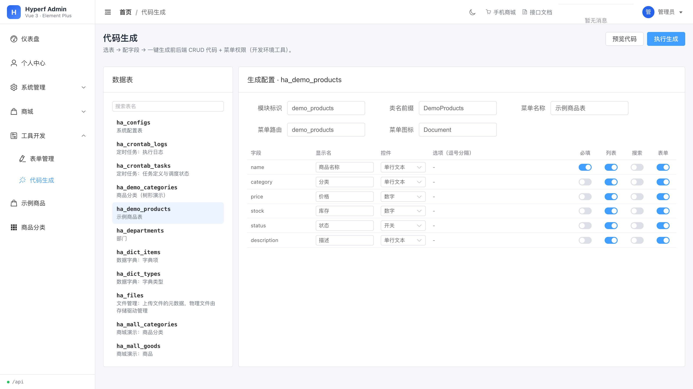
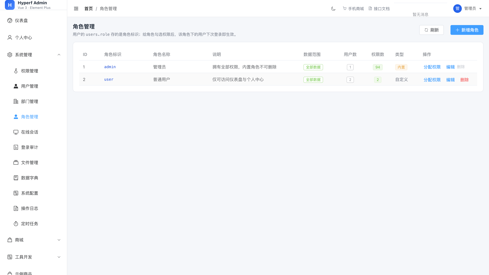
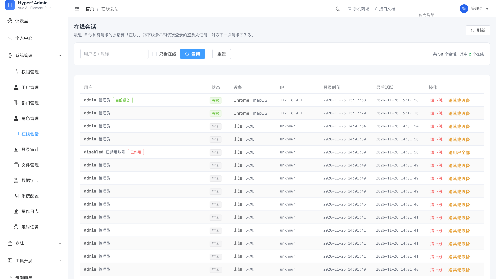
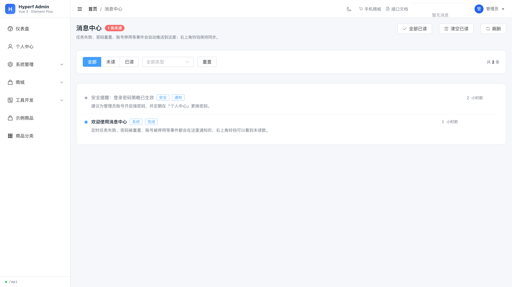
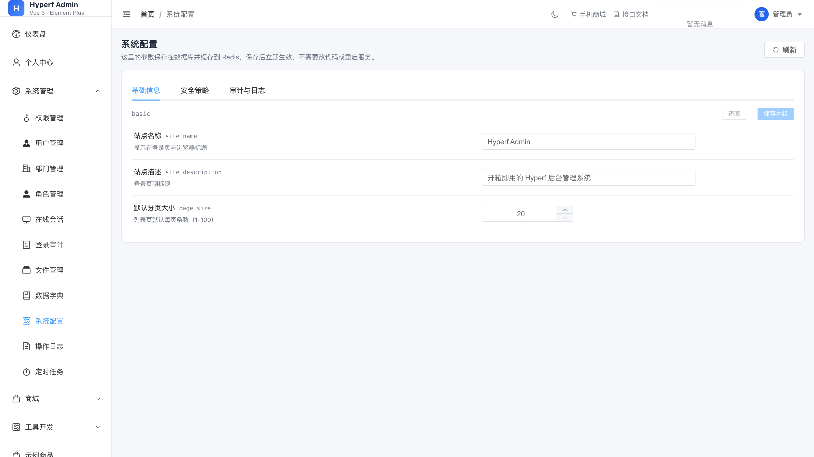

<div align="center">

# Hyperf Admin

**Out-of-the-box admin system** — Hyperf 3 (PHP 8.1 / Swoole) + Vue 3 + Element Plus + TypeScript

Tree-based RBAC (menus + buttons) · JWT dual-token auth · login audit · form designer · full-stack CRUD code generator

[](https://github.com/wywk/hyperf-admin/actions/workflows/ci.yml)
[](LICENSE)
[](https://www.php.net/)
[](https://www.hyperf.io/)
[](https://vuejs.org/)

English | [简体中文](README.md)

### ✨ Screenshots



| Dashboard | User Management |
|---|---|
|  |  |

| Departments & Data Scope | Code Generator |
|---|---|
|  |  |

<details>
<summary>📋 More screenshots</summary>

| Roles & Data Scope | Online Sessions |
|---|---|
|  |  |

| Notifications | System Config |
|---|---|
|  |  |

Login page: 

</details>

</div>

---

## Features

| Module | Description |
|---|---|
| 🔐 Auth | JWT dual token (access 2h / refresh 7d auto rotation), token family revocation, `jti` blacklist, login rate limiting (Redis), multi-device invalidation |
| 🌳 Tree RBAC | Permissions form a tree: `menu` (menus/directories, multi-level) + `button`. Roles are granted by checking the tree; `/auth/me` returns the **menu tree** (drives the sidebar) + **permission codes** (drive `v-permission` and backend checks) |
| 🛡️ API authorization | `AuthMiddleware` handles login at the routing layer; `authorize('xxx.yyy')` enforces permission codes inside controllers; permission resolution is Redis-cached with instant invalidation on writes |
| 📋 Login audit | Full record of login/logout/failures (IP, UA, event) with paged query API + admin page, configurable retention and a built-in prune command |
| 🧾 Form designer | Visual form builder (input / number / select / radio / checkbox / switch / date) exporting **JSON Schema**; built-in render engine; collect submissions via a public endpoint after publishing |
| ⚙️ Code generator | Pick a table + configure fields → generates **backend** (Model / Service / Controller / route block / validation) + **frontend** (api module / list page / form dialog) + auto-registers menus and button permissions |
| 📁 File management | Storage driver abstraction (local driver out of the box; implement `DriverInterface` for OSS/S3/COS), upload whitelist + size limit + real MIME sniffing, public URLs, thumbnail preview |
| 📚 Data dictionary | Two-level dict types + items; business reads select options via `/api/dict/{code}` / `/api/dict/batch` (Redis-cached, invalidated on writes) |
| 📊 Excel import/export | Generic service (openspout streaming); the code generator adds `/export` + `/import` endpoints and frontend buttons to every module: full-dataset export with filters, template round-trip import with per-row validation and failure detail report |
| 📖 API docs | Zero-dependency OpenAPI 3.0 doc page (`/api/docs`), maintained alongside code via lightweight `Sw*` attributes |
| 🐳 Deployment | Production Dockerfile (layered caching / health check / auto-migration on boot) + `docker-compose.prod.yml` one-command stack |

**Stack**: Hyperf 3.1 · Swoole · MySQL 5.7+ · Redis · Vue 3.5 · Vite 6 · Pinia · Vue Router 4 · Element Plus 2.11 · TypeScript

## Quick start

### Docker Compose dev environment (recommended)

```bash
git clone https://github.com/wywk/hyperf-admin.git
cd hyperf-admin
cp .env.example .env

# Brings up backend + MySQL + Redis + frontend (hot reload)
docker compose -f docker-compose.dev.yml up -d

# First run: create tables + seed base data (once the app container is ready)
docker compose -f docker-compose.dev.yml exec app php bin/hyperf.php migrate
docker compose -f docker-compose.dev.yml exec app php bin/hyperf.php db:seed
# (optional) generate demo data: 50 users, 4-level department tree, 30 days of logs, sample jobs & notifications
docker compose -f docker-compose.dev.yml exec app php bin/hyperf.php demo:seed
```

- Backend API: http://127.0.0.1:9501 · Frontend: http://127.0.0.1:5173

### Production

```bash
git clone https://github.com/wywk/hyperf-admin.git
cd hyperf-admin

cp .env.example .env.prod
# Generate a secret: openssl rand -base64 48

docker compose -f docker-compose.prod.yml --env-file .env.prod up -d --build
# Ready once the app container reports healthy; tables + base data are created on first boot
```

### Local development (without Docker)

```bash
# Backend (requires PHP 8.1 + Swoole 5 + MySQL + Redis)
composer install
cp .env.example .env          # adjust database/redis connections
php bin/hyperf.php migrate    # create tables
php bin/hyperf.php db:seed    # base data (permission tree / roles / test accounts)
php bin/hyperf.php demo:seed  # (optional) demo data for an instant populated UI; idempotent, --fresh to rebuild
php bin/hyperf.php start      # serves :9501

# Frontend
cd frontend
npm install
npm run dev                   # serves :5173, /api proxied to :9501
```

Open http://127.0.0.1:5173, default accounts:

| Account | Password | Note |
|---|---|---|
| `admin` | `admin123456` | Full menus and permissions |
| `demo` | `demo123456` | Dashboard & profile only (demonstrates permission filtering) |

> ⚠️ Before going live: change default passwords, delete the demo account, and rotate `JWT_SECRET`.

## Database convention (unified table prefix)

All tables share the `ha_` prefix (short for *hyperf-admin*), controlled by `DB_PREFIX` in `.env`. In code you **never write the prefix** — models, query builders and migrations all get it applied automatically; only raw SQL (e.g. `information_schema`) needs the full physical name.

## Testing

```bash
mysql -h <host> -u root -p -e "CREATE DATABASE IF NOT EXISTS hyperf_admin_test DEFAULT CHARACTER SET utf8mb4 COLLATE utf8mb4_unicode_ci;"
DB_DATABASE=hyperf_admin_test php bin/hyperf.php migrate --force
DB_DATABASE=hyperf_admin_test php bin/hyperf.php db:seed --force
php test/run.php   # runs phpunit inside a Swoole coroutine
```

Covers: JWT auth flow (login / refresh / logout invalidation), RBAC (permission tree, role sync, cache), and the code generator (dry-run output, attribute style, table/field validation). CI runs the same suite on every push/PR.

## Contributing

Issues and PRs are welcome — see [CONTRIBUTING.md](CONTRIBUTING.md).

## License

[MIT](LICENSE)
